# CONSTRUCTOR AI

**Build software. Verify everything. Keep humans in control.**

**Founder • Owner • CEO:** Alexander Romaskevich · **RomaskevicH**  
**Authority:** Architect / Final Architectural Decision Authority  
**IMPERIAL Core intelligence:** **VELEON** · **HANTER** for mission coordination  
**Project status:** Active engineering · Free-only prototype · **NOT a verified autonomous software factory**  
**Reference release:** `0.3.0` (Task Manager + gated planning + quarantine of untrusted draft files; real inference not yet verified)

> **Evidence boundary:** This repository now contains a real, dependency-free **Task Manager reference application** and an automated CI workflow. They do **not** establish live provider inference, secure execution of arbitrary generated code, customer-ready hosting, full end-to-end browser tests or a production CONSTRUCTOR AI v1.0. GitHub Actions checks must be read from actual run status; source files alone are not a passing CI attestation.

## Official IMPERIAL Core web identity

**[Alexander Romaskevich — official founder site](https://oromaskevic23-cmd.github.io/oromaskevic23-cmd/)** · **[IMPERIAL Core — official ecosystem site](https://oromaskevic23-cmd.github.io/IMPERIAL-Core-Public/)**

Alexander Romaskevich · Александр Николаевич Ромаскевич · RomaskevicH — founder-declared Architect, Owner and CEO of IMPERIAL Core. Both owner-maintained GitHub Pages sites provide 10 language versions. Their visibility on the public web is established; Google Search Console verification and indexing are separate, not claimed by these links.


## Run the reference app

Requires **Node.js 22 or later**. No credentials, external model keys, paid services or dependency downloads needed.

```bash
npm run verify
npm start
```

Open **http://127.0.0.1:4173**. The app supports adding, editing, completing, filtering and deleting tasks. Tasks are saved to this browser's **localStorage only**; there is no account, database, cloud sync, external payments or autonomous AI action.

```bash
npm test            # Node built-in domain tests + HTTP smoke tests
npm run check       # JavaScript syntax checks
npm run verify      # Checks + tests + SHA-256 source inventory
```

## AI planning gateway v0.2 — secure, plan-only prototype

The repository now includes a **fixed-origin Groq adapter and constrained, validated proposal contract**, intentionally separate from the browser Task Manager. No server secrets are exposed to the frontend. The draft gateway **never executes generated source, modifies the repository, provisions infrastructure or releases software**.

- Source: [engineering/groq-gateway.mjs](engineering/groq-gateway.mjs), [engineering/draft-contract.mjs](engineering/draft-contract.mjs).
- Local permit gate: [engineering/local-permit.mjs](engineering/local-permit.mjs); short-lived, single-use HMAC permit for **planning only**. This is **NOT** an operational distributed AI Passport or a proof of human identity.
- Runner: [engineering/plan-only.mjs](engineering/plan-only.mjs); CLI: [tools/generate-plan.mjs](tools/generate-plan.mjs).
- Negative-path unit tests: [test/plan-contract.test.js](test/plan-contract.test.js), [test/groq-gateway.test.js](test/groq-gateway.test.js), [test/local-permit.test.js](test/local-permit.test.js), [test/cli.test.js](test/cli.test.js).
- Detailed scope / commands: [AI Model Gateway](docs/AI_MODEL_GATEWAY.md).

**All provider tests run with an injected mock transport. They are not evidence of a live Groq call.** A legitimate server-side `GROQ_API_KEY`, model ID and local `PLAN_AUTH_KEY` must be explicitly configured to try the real provider. Until then, live inference remains **BLOCKED / NOT VERIFIED**. API quota/cost policies must be reviewed by the owner before the first real call.

## FreeLLMAPI adapter — optional, internal FREE_ONLY reference

CONSTRUCTOR AI now includes an **optional** OpenAI-compatible [FreeLLMAPI](https://github.com/tashfeenahmed/freellmapi) client for validated plan-only drafts, selectable via `--provider freellmapi`. **No proxy installation, live inference, customer-ready deployment or free-provider quota is verified.** The original Groq route remains the default.

This adapter requires a separately running, single-user, owner-controlled FreeLLMAPI server and explicit confirmation of non-billable provider routes; it refuses unapproved URLs, tool calls and incomplete responses. Provider quotas and terms still apply. No automatic paid fallback is permitted by CONSTRUCTOR AI; the upstream router's own free-chain configuration must be independently checked.

[Integration, licensing, requirements and activation instructions](docs/FREELLMAPI_INTEGRATION.md) · [Adapter](engineering/freellmapi-gateway.mjs) · [Contract tests](test/freellmapi-gateway.test.js).

## Proof-carrying quarantine v0.3 — NOT an execution sandbox

CONSTRUCTOR AI now includes a restricted local file packager for **validated, untrusted AI draft text**, with SHA-256 integrity checks and an explicit DENIED release status. It never compiles, runs, hosts or deploys generated code.

- [Source: proof-bundle.mjs](engineering/proof-bundle.mjs) — exclusive file writes into a new private directory, file-by-file hashes and byte-by-byte re-verification.
- [Heuristic risk review](engineering/static-review.mjs) — flags runtime capabilities and blocks unmistakable secret-like tokens. A clean heuristic is **not proof of safety**.
- [Offline integration test](test/offline-integration.test.js) — mocked provider → local permit → validated draft → quarantine → read-back verification. No actual Groq API call.
- [Tampering tests](test/proof-bundle.test.js) — symlinks, content changes, manifest edits, unexpected files, bad receipts and secret blocking.
- [Operational details and limitations](docs/PROOF_QUARANTINE.md).

Run offline checks with `npm run verify`. Verify a stored package with `npm run proof:verify -- --bundle PATH`. To invoke the real provider and write a package, use `npm run plan -- --goal "Create task app" --confirm-inference --quarantine-root ./trusted-existing-dir --confirm-quarantine` after authorized free-tier credential setup.

**Security boundary:** hashes here prove local byte consistency, **not origin or signatures**. The HMAC permit is process-local and cannot authenticate a human or production release. An untrusted draft stays DENIED until hardened sandbox execution, independent QA and owner approval are built and verified.
## Engineering evidence map

| Gate | What this repository demonstrates | Current evidence |
|---|---|---|
| E0 — Architecture | Product and threat models, diagrams, workflow | [Platform architecture](docs/PLATFORM_ARCHITECTURE.md) |
| E1 — Contract | Domain requirements and acceptance cases | [Verified engineering standard](docs/VERIFIED_ENGINEERING_STANDARD.md) |
| E2 — Implementation | Working reference source, **not AI generation** | [src/tasks.js](src/tasks.js), [src/app.js](src/app.js), [index.html](index.html) |
| E3 — Unit/static | Executable tests and source inventory | [test/](test/), [CI workflow](.github/workflows/ci.yml) — see real run results |
| E4 — Integration | HTTP static-serving smoke tests only | [test/server.test.js](test/server.test.js); no independent platform integration claim |
| E5 — Runtime / browser | Human browser E2E and AI agent pipeline | **NOT VERIFIED** |
| E6 — Production | Secure platform running for users | **NOT VERIFIED** |

Never treat an architectural intention as an implemented or tested feature. **NO EVIDENCE → NO VERIFIED CLAIM.**

## What makes this stricter than a typical Enterprise documentation package?

1. **Executable claims:** source + tested contracts, not only promises in README.
2. **Dependency-free reference:** local verification at zero model/API cost.
3. **Automated checks:** PR and main-branch test workflow, with source-digest artifact.
4. **Zero Trust:** untrusted generated code cannot run in this reference; no model credentials in browser.
5. **Scoped local draft permit:** tested HMAC gate implemented for plan-only requests; production-grade distributed Agent Passport and privileged approvals remain future work.
6. **Independent QA target:** coder and verifier duties separated in future platform builds.
7. **Human release gate:** no production deployment/financial activity without explicit owner approval.
8. **Evidence tiers:** E0–E6 and truthful status labels.
9. **Threat boundaries:** localStorage demo != production backend, container or sandbox.
10. **Traceable changes:** Conventional Commits, ownership reviews and no rewritten Git history.

**Important:** The workflow file and CODEOWNERS do not themselves enforce branch protection, repository rulesets or passing status checks. Those need real configuration and a verified run.

## Canonical planned platform flow

```mermaid
flowchart LR
  User["User requirements"] --> Lock["IntentLock"]
  Lock --> Plan["HANTER / VELEON planning"]
  Plan --> Agent["Universal NCA engineering roles"]
  Agent --> Gate["AI Passport / Guardian Core / Approval Gateway"]
  Gate --> Sandbox["Isolated build sandbox (future)"]
  Sandbox --> Tests["Build + tests + independent QA"]
  Tests --> Proof["ProofGraph + Proof Passport"]
  Proof --> Human["Human release authorization"]
  Human --> Artifact["Release artifact"]
```



This diagram is a **design target**. The Task Manager demo exercises only the local application/reference-test portion, not the full AI orchestration chain. CONSTRUCTOR AI is a product in the founder-led IMPERIAL Core architectural initiative, developed by one human with LLM tools. LLM assistance is not legal authorship of third-party model weights or external dependencies.

## Documents

- [Proof quarantine operations and security limits](docs/PROOF_QUARANTINE.md)
- [Real GitHub CI PASS evidence for the first reference](docs/VERIFIED_CI_RUN_2026-10-24.md)
- [Competitive parity and five-year engineering moat](docs/COMPETITIVE_PARITY.md)
- [Architecture, boundaries and explicit integration contracts](docs/PLATFORM_ARCHITECTURE.md)
- [Beyond Enterprise / Verified Engineering standard](docs/VERIFIED_ENGINEERING_STANDARD.md)
- [Release and evidence gates](docs/RELEASE_GATES.md)
- [Security policy](SECURITY.md)
- [Contribution and review policy](CONTRIBUTING.md)
- [Enterprise readiness audit](ENTERPRISE_READINESS.md)
- [Enterprise commit standard](ENTERPRISE_COMMIT_STANDARD.md)
- [Earlier complete public architecture / diagrams / investor proposals — archival reference](docs/LEGACY_PUBLIC_BLUEPRINT.md)

## Milestone B — FIRST verified AI-generated application (still pending)

To call the full platform milestone verified, independently demonstrate and retain evidence for:

- Real model response → approved plan → generated source files.
- Isolated, authenticated sandbox build; untrusted code cannot access host secrets.
- Test-run evidence, independent QA, error recovery and provenance.
- Signed mission/agent permits, human release approval, revocation and logs.
- Exportable application + reproducible build + Proof Passport.

**No fake readiness percentage or production claim.** Upgrade status only after the corresponding commands run in their real environments.

© 2026 Alexander Romaskevich · RomaskevicH. No software license grant is implied by repository visibility. Historical upstream attribution and other legal rights remain applicable.

## Founder profile and public milestone — 25 October 2026

[Canonical founder identity](https://github.com/oromaskevic23-cmd/IMPERIAL-Core-Public/blob/main/docs/FOUNDER_IDENTITY.md) · [IMPERIAL Core portfolio](https://github.com/oromaskevic23-cmd/IMPERIAL-Core-Public/blob/main/docs/PORTFOLIO.md).

**68/68 PASS** observed in [CI job](https://github.com/oromaskevic23-cmd/CONSTRUCTOR-AI/actions/runs/40131861437/job/120985060759) for [commit `23d25fa`](https://github.com/oromaskevic23-cmd/CONSTRUCTOR-AI/commit/23d25fa41287001c3529dad23571e67c04ddb74a) in [open PR #1](https://github.com/oromaskevic23-cmd/CONSTRUCTOR-AI/pull/1). This is unmerged PR evidence, not the default-branch test count or a production release. Model endpoints are mocked. HANTER is AI Command Center / Chief Systems, under the founder's final architectural decisions.
