# CONSTRUCTOR AI

**Build software. Verify everything. Keep humans in control.**

**Founder / Chief Systems Architect:** Alexander Romaskevich · **RomaskevicH**  
**IMPERIAL Core intelligence:** **VELEON** · **HANTER** for mission coordination  
**Project status:** Active engineering · Free-only prototype · **NOT a verified autonomous software factory**  
**Reference release:** `0.1.0` source-only (browser Task Manager)

> **Evidence boundary:** This repository now contains a real, dependency-free **Task Manager reference application** and an automated CI workflow. They do **not** establish working LLM inference, secure execution of arbitrary generated code, customer-ready hosting, full end-to-end browser tests or a production CONSTRUCTOR AI v1.0. GitHub Actions checks must be read from actual run status; source files alone are not a passing CI attestation.

## Run the reference app

Requires **Node.js 22 or later**. No credentials, external model keys, paid services or dependency downloads needed.

```bash
npm run verify
npm start
```

Open **http://127.0.0.1:4173**. The app supports adding, editing, completing, filtering and deleting tasks. Tasks are saved to this browser's **localStorage only**; there is no account, database, cloud sync, external payments or autonomous AI action.

```bash
npm test            # Node built-in domain tests + HTTP smoke tests
npm run check       # JavaScript syntax checks
npm run verify      # Checks + tests + SHA-256 source inventory
```

## Engineering evidence map

| Gate | What this repository demonstrates | Current evidence |
|---|---|---|
| E0 — Architecture | Product and threat models, diagrams, workflow | [Platform architecture](docs/PLATFORM_ARCHITECTURE.md) |
| E1 — Contract | Domain requirements and acceptance cases | [Verified engineering standard](docs/VERIFIED_ENGINEERING_STANDARD.md) |
| E2 — Implementation | Working reference source, **not AI generation** | [src/tasks.js](src/tasks.js), [src/app.js](src/app.js), [index.html](index.html) |
| E3 — Unit/static | Executable tests and source inventory | [test/](test/), [CI workflow](.github/workflows/ci.yml) — see real run results |
| E4 — Integration | HTTP static-serving smoke tests only | [test/server.test.js](test/server.test.js); no independent platform integration claim |
| E5 — Runtime / browser | Human browser E2E and AI agent pipeline | **NOT VERIFIED** |
| E6 — Production | Secure platform running for users | **NOT VERIFIED** |

Never treat an architectural intention as an implemented or tested feature. **NO EVIDENCE → NO VERIFIED CLAIM.**

## What makes this stricter than a typical Enterprise documentation package?

1. **Executable claims:** source + tested contracts, not only promises in README.
2. **Dependency-free reference:** local verification at zero model/API cost.
3. **Automated checks:** PR and main-branch test workflow, with source-digest artifact.
4. **Zero Trust:** untrusted generated code cannot run in this reference; no model credentials in browser.
5. **Signed-permit design:** architecture requires scoped authorization; this demo does **not** claim those controls are implemented.
6. **Independent QA target:** coder and verifier duties separated in future platform builds.
7. **Human release gate:** no production deployment/financial activity without explicit owner approval.
8. **Evidence tiers:** E0–E6 and truthful status labels.
9. **Threat boundaries:** localStorage demo != production backend, container or sandbox.
10. **Traceable changes:** Conventional Commits, ownership reviews and no rewritten Git history.

**Important:** The workflow file and CODEOWNERS do not themselves enforce branch protection, repository rulesets or passing status checks. Those need real configuration and a verified run.

## Canonical planned platform flow

```mermaid
flowchart LR
  User["User requirements"] --> Lock["IntentLock"]
  Lock --> Plan["HANTER / VELEON planning"]
  Plan --> Agent["Universal NCA engineering roles"]
  Agent --> Gate["AI Passport / Guardian Core / Approval Gateway"]
  Gate --> Sandbox["Isolated build sandbox (future)"]
  Sandbox --> Tests["Build + tests + independent QA"]
  Tests --> Proof["ProofGraph + Proof Passport"]
  Proof --> Human["Human release authorization"]
  Human --> Artifact["Release artifact"]
```



This diagram is a **design target**. The Task Manager demo exercises only the local application/reference-test portion, not the full AI orchestration chain. CONSTRUCTOR AI is a product in the founder-led IMPERIAL Core architectural initiative, developed by one human with LLM tools. LLM assistance is not legal authorship of third-party model weights or external dependencies.

## Documents

- [Architecture, boundaries and explicit integration contracts](docs/PLATFORM_ARCHITECTURE.md)
- [Beyond Enterprise / Verified Engineering standard](docs/VERIFIED_ENGINEERING_STANDARD.md)
- [Release and evidence gates](docs/RELEASE_GATES.md)
- [Security policy](SECURITY.md)
- [Contribution and review policy](CONTRIBUTING.md)
- [Enterprise readiness audit](ENTERPRISE_READINESS.md)
- [Enterprise commit standard](ENTERPRISE_COMMIT_STANDARD.md)
- [Earlier complete public architecture / diagrams / investor proposals — archival reference](docs/LEGACY_PUBLIC_BLUEPRINT.md)

## Milestone B — FIRST verified AI-generated application (still pending)

To call the full platform milestone verified, independently demonstrate and retain evidence for:

- Real model response → approved plan → generated source files.
- Isolated, authenticated sandbox build; untrusted code cannot access host secrets.
- Test-run evidence, independent QA, error recovery and provenance.
- Signed mission/agent permits, human release approval, revocation and logs.
- Exportable application + reproducible build + Proof Passport.

**No fake readiness percentage or production claim.** Upgrade status only after the corresponding commands run in their real environments.

© 2026 Alexander Romaskevich · RomaskevicH. No software license grant is implied by repository visibility. Historical upstream attribution and other legal rights remain applicable.
