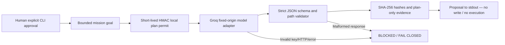

# CONSTRUCTOR AI — Verified AI Planning Gateway v0.2

**Stage:** E2 source / E3 verification after successful real CI.  
**Objective:** safely prepare validated engineering draft proposals for future model→build→test orchestration.  
**Owner:** Alexander Romaskevich (RomaskevicH)  
**Provider:** Groq official fixed HTTPS API endpoint: `https://api.groq.com/openai/v1/chat/completions`  
**Status:** No real inference verified in this repository yet; network requests are **opt-in only**.

## Implemented architecture



**Important:** a locally generated HMAC permit proves that the *local shared-secret holder* initiated the request; it is **not** independently authenticated human consent, a full AI Passport, a globally replay-resistant permit, proof of current model performance or authorization to execute generated code. The replay set is **process-local** and not persisted across workers: never use this as a production security control.

## Strict output contract

Model response must be JSON:

```json
{
  "schema": "constructor_draft_v1",
  "summary": "Short summary",
  "steps": [{"id": "design", "action": "Plan the UI", "acceptance": "Documented acceptance"}],
  "files": [{"path": "src/main.js", "content": "/* proposal only */"}]
}
```

Limits: 1–12 steps; at most 8 files and 32 KiB total; short bounded text; restricted relative paths and extensions; no dotfiles, parent traversal or secret paths; no extra top-level fields. **Validated format is not secure executable code.** AI-proposed code is untrusted, cannot run under this pipeline, and must pass a future isolated sandbox + independent QA gate before usage.

## Offline verification (free)

```bash
npm run check
npm test
npm run verify
node tools/generate-plan.mjs --help
```

Node built-in tests inject fake provider responses and simulate credential failure, tampering, expired/replayed permits, schema defects and invalid paths. They do not call the provider or spend usage.

## Opt-in real-model plan request (owner action only)

In an authorized local server environment, set `GROQ_API_KEY` and `GROQ_MODEL` (a currently active supported model identifier) using the server's secret store, and `PLAN_AUTH_KEY` (a fresh random secret of at least 32 bytes). **Do not commit these to GitHub or enter them into the browser.** Then:

```bash
npm run plan -- --goal "Generate a draft Task Manager architecture" --confirm-inference
```

No inference is attempted if parameters or the explicit flag are missing. This is a third-party provider request, so users must verify the free-tier quotas and billing settings before invocation. Provider errors return stable non-secret error codes; draft JSON returns to stdout if valid.

## Next gates

1. Independent verification with **real, authorized Groq Free credentials** and a successful signed response record.
2. Domain-separated job queue, persistent scoped permits, distributed replay prevention and owner-authenticated approvals.
3. Isolated sandbox to build proposals without access to host/network/secrets, followed by build/unit/integration tests.
4. Independent QA, ProofGraph/Proof Passport, replayable error recovery and a human release gate.
5. Full user-level browser E2E and benchmark comparison with Cursor, Replit Agent and Codex.

**What is not implemented:** model-independent runtime federation, cross-platform tool access, production Agent Passport, secure arbitrary-code sandbox, NCA workforce production orchestration or deployment/release by agents.

**External reference:** [Groq official API Reference](https://console.groq.com/docs/api-reference). Feature support and model availability may change.
