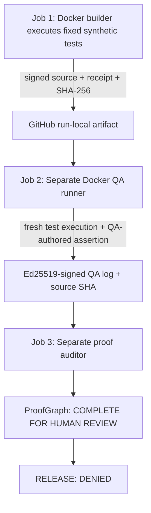

# CONSTRUCTOR AI — Three-Stage Independent CI QA v0.1

**Status:** Tested at [GitHub Actions run 40193519823](https://github.com/oromaskevic23-cmd/CONSTRUCTOR-AI/actions/runs/40193519823), commit `0f843c5eab80f3a026977f7a87f03ae42921f07b`. This proves **separate CI-job execution and self-issued cryptographic integrity**, *not* independent human review, accredited certification, provider attestation or a production-ready release.

## What is actually implemented



Every stage uses source from the **same PR revision**, and each job runs on a separate GitHub-hosted VM. The builder signs an evidence envelope with an ephemeral Ed25519 key. The QA runner downloads the builder artifact, checks its signature and exact source/receipt hashes, repeats the original test program with an independently authored QA assertion in its own bounded Docker container, and signs its **own actual execution log** with another ephemeral key. The third job downloads the final bundle and independently verifies:

- Signature integrity and distinct public keys;
- SHA-256 of source, both execution receipts and the predecessor envelope;
- Same mission, requirement, immutable local Docker image ID and QA-owned test source;
- Consistent graph of SOURCE, TEST and INDEPENDENT_QA evidence;
- No missing, cross-mission, forged, substituted, nonzero-result or unattested Docker-mock evidence;
- Release **DENIED** and owner authorization **NOT VERIFIED**, regardless of proof completeness.

Files: [qa-chain.mjs](../engineering/qa-chain.mjs), [independent-qa-ci.mjs](../tools/independent-qa-ci.mjs), [verify-qa-ci.mjs](../tools/verify-qa-ci.mjs), [test/qa-chain.test.js](../test/qa-chain.test.js) and [CI](../.github/workflows/ci.yml).

The successful run recorded **134/134 Node tests**, plus separate `docker-isolation`, `independent-qa` and `proof-audit` jobs. Their public GitHub logs form the current proof source. The uploaded artifacts `ci-builder-evidence`, `ci-qa-chain`, and `ci-qa-verdict` are retained for 14 days.

## Reproduce / independently inspect

```bash
npm run verify
# On an authorized Docker test host, with node:22-alpine installed:
export CONSTRUCTOR_DOCKER_IMAGE_ID="$(docker image inspect --format '{{.Id}}' node:22-alpine)"
CONSTRUCTOR_QA_BUILD_OUTPUT=ci-builder-evidence.json npm run isolated:demo
npm run qa:independent
npm run qa:audit
```

The local commands operate sequentially, so they **do not reproduce job-level independence**. Verify actual independence against the GitHub Actions graph and signed job logs. The artifact files are intentionally generated only after successful execution.

## Security limitation — self-issued keys are not trusted identities

The current Ed25519 keypairs are generated inside CI jobs; the bundle carries the public keys itself. **Anyone who can forge the complete chain can generate replacement keypairs and valid signatures.** GitHub runner logs and exact-job artifact origin are the external process evidence; the signatures alone do not prove which organization or human signed. Production requires pre-enrolled and revocable trust roots, workload identity bound to CI OIDC, provenance attestation, durable nonce storage and independently administered QA.

**Independent CI process ≠ independent human QA.** The QA tests are a repeat of an intentionally synthetic example with an extra QA-owned assertion, not a broad test suite for AI-generated real applications. Both environments use Docker, which shares the runner VM kernel. None of this supplies a hardened microVM or proves the safety of arbitrary hostile code.

## Release and next milestone

`READY_FOR_HUMAN_EVIDENCE_REVIEW` means all **claimed** proof categories are present for this small controlled test and their chain is internally consistent. It is **not** a product release. No owner signature exists; `release: DENIED` is mandatory.

Next: trusted LLM-generated multi-file app source → independently anchored model output → VM-isolated build/test (not host Docker) → external reviewer-owned QA → durable provenance / owner-signed release permit. **Not verified yet.**
