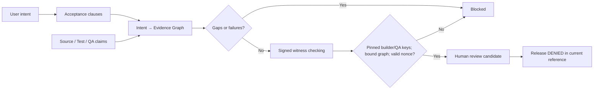

# CONSTRUCTOR AI — Technical Investment Brief

**Build software. Verify everything. Keep humans in control.**

**Category hypothesis:** *evidence-first software engineering*. CONSTRUCTOR AI is being built as a product in which generated software must be linked to explicit user acceptance criteria, reviewable source artifacts, test results and ultimately independently authorized release. It is **not** a rebranded coding assistant or an already proven autonomous application factory.

**Founder and architectural authority:** Alexander Romaskevich (RomaskevicH), IMPERIAL Core. This is a technical founder-led project description, not evidence of a registered corporation, patents, exclusive third-party IP rights, outside investment or audited revenue.

## The problem worth solving

Code generation is not the same as software acceptance. A repository, confident LLM response, passing unit suite or source checksum can all exist without proving that the application meets its requirements, received independent QA or has permission to be released.

**Product thesis:** move the engineering handoff from **prompt → unverified code** toward **intent → candidate → recorded gaps → independently verified evidence → explicitly controlled release**.

This is a *proposed product differentiator*. Other software development platforms also have tests, secure sandboxes, code review and approvals; we do not claim to have invented these concepts or to outperform incumbents today.

## What is genuinely implemented in this repository

| First-party engineering component | Exact executable source | Verified scope | Remaining boundary |
|---|---|---|---|
| Dependency-free Task Manager reference | [Task state](../src/tasks.js) · [local UI](../src/app.js) · [HTTP server](../tools/serve.mjs) | Local CRUD and smoke tests | Not an AI-generated or customer-deployed app |
| Constrained model draft adapter | [Draft contract](../engineering/draft-contract.mjs) · [Groq adapter](../engineering/groq-gateway.mjs) | Mocked transport; rejection tests | Live inference NOT VERIFIED |
| Short-lived local HMAC plan permit | [Local permit](../engineering/local-permit.mjs) | Local replay / expiry checks | Not an owner identity attestation |
| Proof-carrying quarantine | [Proof bundle](../engineering/proof-bundle.mjs) | SHA-256 source consistency and tamper rejection | No code execution, no signed provenance |
| **New: Intent → Evidence Graph** | [Graph evaluator](../engineering/intent-proof-graph.mjs) · [tests](../test/intent-proof-graph.test.js) | Deterministic requirement coverage, visible gaps, fail-closed release | Evidence labels and SHA references are untrusted |
| **New: Pinned Proof Witness** | [Ed25519 witness verifier](../engineering/proof-witness.mjs) · [tests](../test/proof-witness.test.js) | Exact graph / requirement / digest binding, two externally pinned signing roles, nonces | Key separation ≠ independent QA execution or human identity; replay store memory-only |

Two new engineering components on [review PR #5](https://github.com/oromaskevic23-cmd/CONSTRUCTOR-AI/pull/5) are authored as dedicated modules, not imported as a library wrapper. Their novelty claim is **an independently implemented, concrete composition inside CONSTRUCTOR AI**, not proof of unique invention, patentability or a defensible five-year monopoly.

## A credible mechanism rather than a badge



**Cryptographic precision:** a successful Ed25519 check means that the bytes were signed by possession of the corresponding private key, assuming the independently supplied public-key pin is trustworthy. It does *not* show that a test really ran, that the QA signer is a separate person, that a source file matches the digest, or that the owner authorized a deployment. In-memory nonce tracking does not survive restart. All actual releases remain **DENIED**.

## Verify it in minutes — no credit card or model key

Requirements: Node.js 22 or later. The repository's reference has no external runtime dependencies.

```bash
npm run verify
npm run proof:graph:demo
npm start
```

The synthetic graph demo illustrates a missing QA witness. To inspect actual source, read [the protocol](PROOFGRAPH_PROTOCOL.md), [the technical diligence map](TECHNICAL_DILIGENCE.md), the [CI workflow](../.github/workflows/ci.yml) and the [PR's exact run history](https://github.com/oromaskevic23-cmd/CONSTRUCTOR-AI/actions). Test counts must be taken from the successful CI run for the *exact revision* and cannot be read as commercial readiness.

## Practical moat hypothesis

The strategic moat is **verification integrated into the normal builder experience**, not marketing claims about having more agents. Potential measurable advantages: proportion of acceptance clauses with externally verifiable proof, independent QA rejections of unsound outputs, rollback success, security violations, complete-task success under fixed budgets, and time to reviewer acceptance.

**Differentiator acceptance conditions** are in [the competitive parity matrix](COMPETITIVE_PARITY.md). Until a public, comparable task benchmark has been run with external evaluators, no claim that CONSTRUCTOR AI is superior to Cursor, Replit, Lovable, Bolt, Codex, Copilot, Windsurf or Devin is warranted.

## Product and commercial stage

**Current:** tested reference engineering. **Not verified:** end-to-end AI-written multi-file applications, independent executed QA, hardened build sandbox, remote autonomous agents, 24/7 hosting, users, paying customers, bank-settled revenue or sales pipeline.

**Near-term go/no-go milestones:** build one complete user-authorized Task Manager lifecycle from actual model output to isolated execution and independent review, expand to CRM and dashboard, validate real user acceptance, then run scoped paid pilots and reconcile payments. This sequence is a **plan**, not a delivery or sales assertion.

## Technical diligence questions invited

Can you reproduce the tests at the PR SHA? Does signing bind to independently pinned public keys? What could fool the graph? How would actual test logs, binary hashes and QA execution be bound? What action can the AI take without human approval? How is the owner kill switch enforced and tested in a deployed environment? What code/IP is first-party versus third-party? What steps separate this reference from a secure production release?

We prefer answers that include concrete links and **NOT VERIFIED** labels to unsupported investor promises.

**Build software. Verify everything.**
