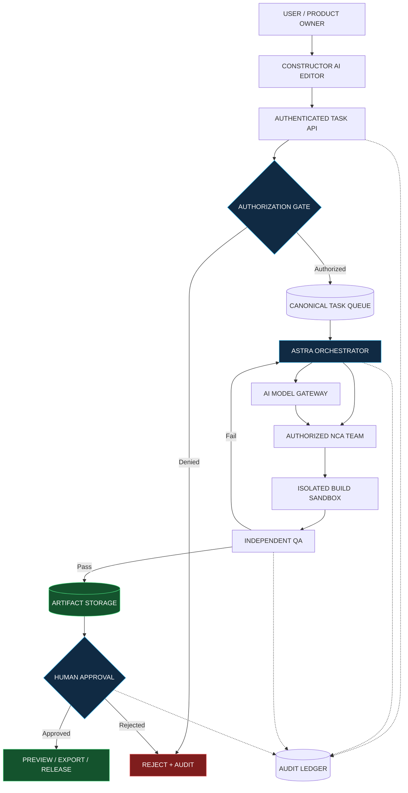
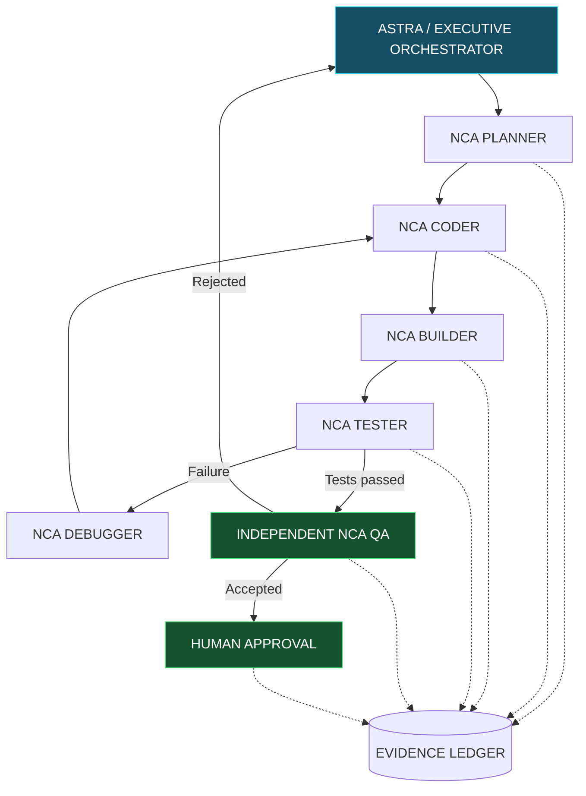
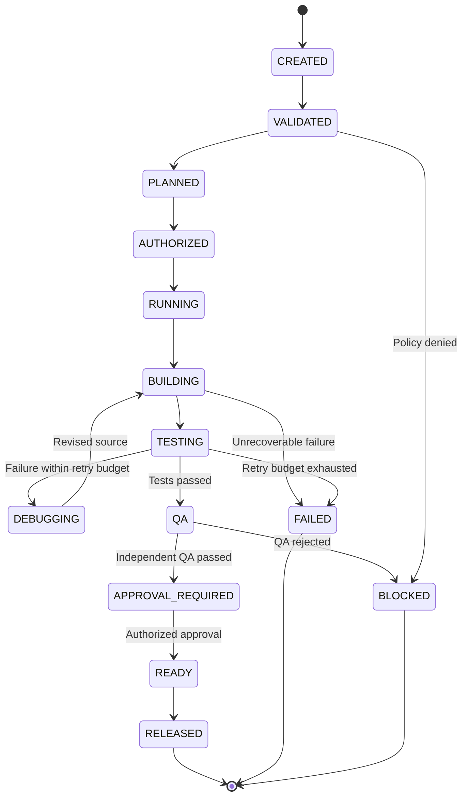
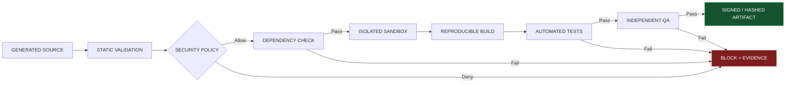
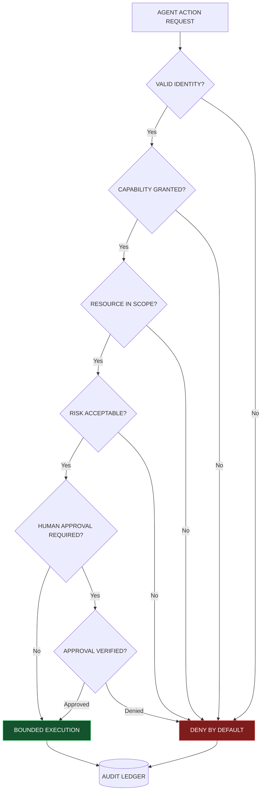
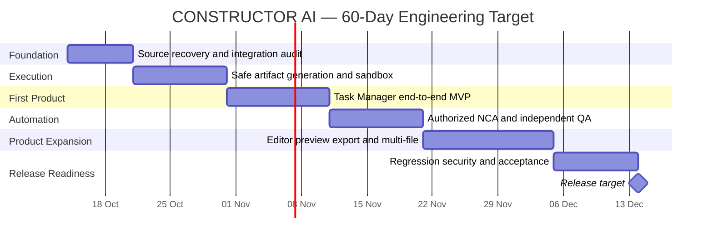
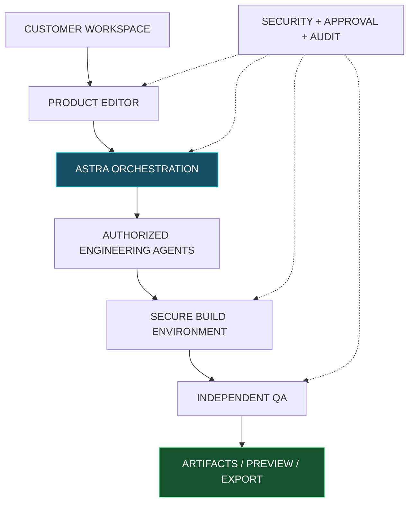
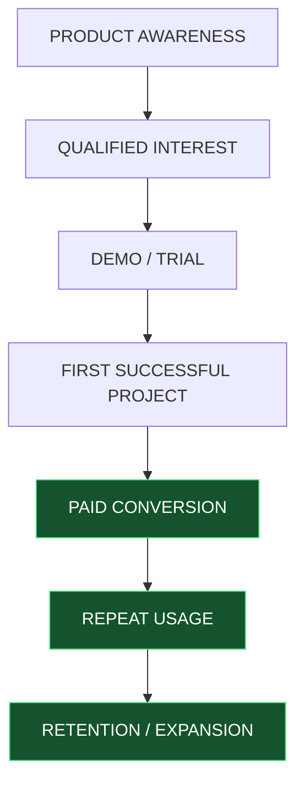

> Archived historical public blueprint preserved from the pre-engineering README, 2026-10-24. The claims below were proposals and historic descriptions, **not independent evidence of operational readiness**. Canonical current documentation is [README.md](../README.md). No edits to the archive content below.

---

> **Enterprise readiness notice — 24 October 2026.** This public repository currently holds `README.md` and Enterprise policy documents, **not an independently verifiable executable product tree, automated test suite or CI run**. Locally reported prototypes and builds must be substantiated by real source, reproducible tests and release artifacts before being represented as deployed capabilities. All historical feature claims below should be read as proposals unless linked to independent evidence. [Repository-by-repository audit](https://github.com/oromaskevic23-cmd/IMPERIAL-Core-US-HoldCo-Founder-Control-Blueprint/blob/main/docs/ENTERPRISE_PORTFOLIO_AUDIT.md).

---

# CONSTRUCTOR-AI
 
CONSTRUCTOR AI — Autonomous Software Engineering Platform by IMPERIAL Core. Transform ideas into working applications through AI-powered planning, coding, building, testing, debugging and independent QA. Founded by Alexander Romaskevich | RomaskevicH.
---
CONSTRUCTOR AI

### From an idea to working software.
**Autonomous Software Engineering Platform by IMPERIAL Core**

**Founder & Chief Systems Architect:** Alexander Romaskevich  
**Official Signature:** RomaskevicH  
**Development Status:** Active Development  
**Target v1.0 Release:** December 14, 2026

---

## The Vision

What if building software started with a simple conversation?

CONSTRUCTOR AI is being developed to transform natural-language requirements into real software projects, combining AI-assisted planning, code generation, building, testing, debugging and independent quality assurance.

**Describe your idea. Review the plan. Build the software. Verify the result.**

## What We're Building

- **AI Software Architect** — translates ideas into technical plans.
- **AI Code Engineer** — generates and improves application source code.
- **Automated Build Engine** — prepares reproducible builds in isolated environments.
- **Intelligent Debugging** — analyzes failures and proposes fixes.
- **Independent Quality Assurance** — separates code generation from final verification.
- **Security by Design** — applies least privilege, authorization and audit controls.
- **Project Workspace** — planned source management, previews and export.
- **Human Approval** — preserves user control over critical actions.

These are product objectives. Individual capabilities will be marked verified only after successful end-to-end testing.

## Who Is It For?

| Audience | Intended Value |
| --- | --- |
| Entrepreneurs | Prototype digital products from business ideas |
| Startups | Accelerate MVP development |
| Developers | Automate repetitive engineering tasks |
| Businesses | Create internal tools and workflows |
| Agencies | Build and iterate on client applications |
| AI Teams | Coordinate authorized engineering agents |

## The Engineering Workflow

TASK → PLAN → CODE → BUILD → TEST → DEBUG → QA → APPROVAL → RELEASE

## First Milestone: Task Manager

Our first end-to-end validation target is a Task Manager application with:

- Task creation, editing and deletion
- Completion tracking
- Persistent data storage
- Responsive interface
- Automated functional tests
- Independent QA evidence

**Current status:** In development. A fully verified Task Manager E2E release has not yet been established.

## Product Roadmap

**Phase 1 — Integration:** Connect existing components, identify the source of truth and validate the task pipeline.

**Phase 2 — Execution:** Enable authorized file generation, isolated builds and automated testing.

**Phase 3 — Verified MVP:** Complete Task Manager with real end-to-end evidence.

**Phase 4 — Product Expansion:** Add multi-file projects, preview, export, debugging and broader application templates.

**Phase 5 — Release Readiness:** Security review, regression testing, documentation and release approval.

**Target:** December 14, 2026. This is a development goal, not a guarantee of availability.

## Commercial Direction

CONSTRUCTOR AI is intended to offer software creation and engineering automation as a service.

Potential commercial models include:
- Free evaluation tier
- Individual developer subscriptions
- Team workspaces
- Business subscriptions
- Enterprise deployment and support

**Pricing, billing and public availability have not been announced. No paid service is implied to be live.**

## Security & Trust

The engineering platform is designed around:

Zero Trust · Least Privilege · Deny by Default · Fail Closed · Independent QA · Human Approval · Audit Evidence

Generated code must be treated as untrusted until tested in an authorized isolated environment.

## About IMPERIAL Core

CONSTRUCTOR AI is a product initiative within the IMPERIAL Core ecosystem, founded by Alexander Romaskevich.

The project aims to make professional software engineering more accessible while maintaining clear accountability, safety and human oversight.

## Project Identity

**Product:** CONSTRUCTOR AI  
**Ecosystem:** IMPERIAL Core  
**Founder:** Alexander Romaskevich  
**Public Signature:** RomaskevicH  
**Copyright:** © 2026 Alexander Romaskevich. All rights reserved.

---

*Build with intelligence. Verify with evidence. Keep humans in control.*

**CONSTRUCTOR AI — by IMPERIAL Core | RomaskevicH**
# CONSTRUCTOR AI — System Architecture

**Product:** CONSTRUCTOR AI
**Ecosystem:** IMPERIAL Core
**Founder & Chief Systems Architect:** Alexander Romaskevich
**Public Signature:** RomaskevicH
**Document Version:** 1.0-draft
**Status:** Engineering Specification — Not a Production Certification
**Target Release:** 14 December 2026

---

## 1. Executive Summary

CONSTRUCTOR AI is an AI-native software engineering platform being developed to convert natural-language requirements into verified software deliverables.

The intended engineering lifecycle is:

TASK → PLAN → CODE → BUILD → TEST → DEBUG → INDEPENDENT QA → APPROVAL → RELEASE

The platform combines human-directed requirements, authorized AI agents, source management, isolated execution, reproducible testing, security controls and evidence-based release approval.

The product is under active development. Features described as planned must not be presented as operational until independently verified.

## 2. Core Engineering Principles

1. Architecture before implementation.
2. Integration before replacement.
3. Evidence before completion claims.
4. Identity does not imply authority.
5. Capability does not imply approval.
6. Intelligence does not imply privilege.
7. Deny by Default and Fail Closed.
8. Human oversight for critical operations.
9. Independent quality assurance.
10. No paid infrastructure without explicit owner authorization.

## 3. Existing Infrastructure and Boundaries

### Supabase

Existing components include a task execution queue, database functions, audit-related records and the constructor-ai-agent Edge Function.

The observed worker version is v10. Its current supported workload is bounded and must not be treated as a general-purpose software execution engine.

### Neon

Neon provides an existing staging database environment.

Its task schema is not assumed to be identical to Supabase. Data ownership, synchronization and schema compatibility must be verified before integration.

### GitHub

GitHub is the version-controlled home for public product documentation and approved source code.

Public repositories must not contain credentials, private infrastructure configurations, customer information or proprietary code not approved for release.

### Netlify

Netlify is a candidate frontend and preview hosting component, subject to verification of the actual project, deployment configuration and access rights.

### AI Model Gateway

The model gateway is intended to generate plans, code proposals and structured engineering outputs.

Model-generated content is untrusted input until validated.

## 4. Logical Architecture

User / Product Editor
        |
        v
Authenticated Task API
        |
        v
Task Validation & Approval Gateway
        |
        v
Canonical Execution Queue
        |
        v
ASTRA Orchestration Layer
        |
        +-- Planner
        +-- Code Generator
        +-- Builder
        +-- Tester
        +-- Debugger
        +-- Independent QA
        |
        v
Authorized Isolated Execution
        |
        v
Artifact Storage & Evidence Ledger
        |
        v
Review / Approval / Preview / Export

This is a target logical flow, not a claim that all links are currently operational.

## 5. System Modules

### 5.1 Product Editor

Responsibilities:
- Accept user requirements.
- Display task progress and execution history.
- Present generated files and test results.
- Allow authorized project revisions.
- Provide safe previews and exports.

### 5.2 Task API

Responsibilities:
- Authenticate requests.
- Validate input schemas.
- Enforce ownership and project boundaries.
- Apply idempotency keys.
- Prevent duplicate execution.
- Record task identifiers and audit events.

### 5.3 ASTRA Orchestrator

Responsibilities:
- Decompose approved tasks.
- Assign work only to authorized agents.
- Track dependencies and retry budgets.
- Enforce capability restrictions.
- Separate implementation from QA.
- Escalate blocked or high-risk operations.

### 5.4 AI Engineering Agents

PLANNER: decomposes requirements and defines acceptance tests.

CODER: produces source changes within approved project boundaries.

BUILDER: performs deterministic builds inside isolated environments.

TESTER: executes functional and integration tests.

DEBUGGER: diagnoses failures and proposes bounded repairs.

QA: independently validates outputs and evidence.

These are functional roles, not a declaration that six live agents have already been deployed.

### 5.5 Secure Build Sandbox

The sandbox must:
- Use non-privileged execution.
- Limit CPU, memory, runtime and disk usage.
- Restrict network access by default.
- Prevent host filesystem access.
- Block access to platform secrets.
- Apply dependency and command allowlists.
- Enforce execution timeouts.
- Preserve reproducible logs and artifacts.
- Destroy temporary environments after use.

No generated program may execute in a privileged control-plane runtime.

### 5.6 Artifact and Evidence Layer

Each execution should record:
- Task ID and project ID.
- Agent ID and authorized capability.
- Input revision and source reference.
- Generated file manifest.
- Build output and test report.
- Security scan results.
- QA decision.
- Approval identity when required.
- Timestamp and artifact checksum.

An artifact without verifiable provenance must not receive release approval.

## 6. Task State Machine

Proposed canonical states:

CREATED
VALIDATED
PLANNED
AUTHORIZED
RUNNING
BUILDING
TESTING
DEBUGGING
QA
APPROVAL_REQUIRED
READY
RELEASED
BLOCKED
FAILED
CANCELLED

State transitions must be validated server-side.

Terminal states must not be silently rewritten.

Retry attempts must be bounded and auditable.

Existing database state values must be mapped explicitly before introducing any new states.

## 7. Security Architecture

The platform follows:

Zero Trust
Deny by Default
Fail Closed
Least Privilege
AI Passport
Guardian Core
Approval Gateway
Audit Ledger
Independent QA
Human Protection Constitution

Security boundaries:
- Authentication is separate from authorization.
- An agent cannot grant itself new privileges.
- Code generation does not authorize code execution.
- Successful tests do not authorize production deployment.
- Critical releases require the appropriate human approval.
- Credentials must remain in approved secret stores.
- Public logs must not expose sensitive information.

CYBER HAK integration is a planned security capability and must be verified before being described as active protection.

## 8. Integration Contracts

### Editor to Task API

Input:
- Project reference
- User requirement
- Idempotency key
- Authorized user context

Output:
- Task ID
- Accepted or rejected status
- Validation errors, if any

### Queue to Worker

Input:
- Task ID
- Approved task kind
- Risk classification
- Scoped capabilities
- Attempt budget

Output:
- Execution status
- Generated artifact references
- Diagnostic information
- Evidence references

### Worker to QA

Input:
- Artifact manifest
- Source revision
- Test results
- Security results

Output:
- PASS, FAIL or BLOCKED
- Findings
- Evidence ID
- Required remediation

All contracts must be versioned and tested before production use.

## 9. First Reference Application — TASK MANAGER

The first end-to-end acceptance target is a responsive task management application.

Required features:
- Create tasks.
- Read tasks.
- Update tasks.
- Delete tasks.
- Mark tasks complete.
- Persist data across reloads.
- Handle invalid input.
- Display useful error messages.

Acceptance checks:
CREATE
READ
UPDATE
DELETE
COMPLETE
PERSISTENCE
BUILD
SECURITY
INDEPENDENT_QA
END_TO_END

All checks require actual execution evidence.

A static mockup does not qualify as a verified application.

## 10. Engineering Milestones

Phase 1 — Recover source access and validate integrations.

Phase 2 — Implement safe artifact generation and isolated builds.

Phase 3 — Deliver verified TASK MANAGER end-to-end.

Phase 4 — Integrate authorized agents and bounded debugging.

Phase 5 — Expand to multi-file projects, preview and export.

Phase 6 — Complete regression testing and release review.

Target release: 14 December 2026.

The target date is a planning objective, not proof of release readiness.

## 11. Definition of Done

A feature is DONE only when:
- Its source revision is identifiable.
- Its required tests actually pass.
- Its security checks are documented.
- Independent QA has reviewed the evidence.
- Required approvals are present.
- The resulting artifact can be reproduced or inspected.

Otherwise use PARTIAL, BLOCKED or NOT STARTED.

## 12. Commercial and Public Communication

CONSTRUCTOR AI is being developed for entrepreneurs, software developers, agencies, startups and business teams.

Possible future offerings include individual subscriptions, team workspaces and enterprise services.

Prices, subscriptions and service availability must not be advertised as live until officially launched.

## 13. Ownership and Attribution

Product: CONSTRUCTOR AI
Ecosystem: IMPERIAL Core
Founder: Alexander Romaskevich
Public Signature: RomaskevicH

Copyright © 2026 Alexander Romaskevich. All rights reserved.

No open-source license is granted merely by publishing this document.

---

**CONSTRUCTOR AI**
Build with intelligence. Verify with evidence. Keep humans in control.
# CONSTRUCTOR AI — Visual Engineering Architecture

> **Architecture as Code · Engineering Blueprint v1.0**
>
> IMPERIAL Core | Founder & Chief Systems Architect: Alexander Romaskevich | RomaskevicH

**Status:** Target architecture / implementation in progress  
**Release target:** 14 December 2026  
**Design principles:** Evidence-first · Zero Trust · Human Control · Independent QA

---

## 01 — End-to-End Platform Architecture

The platform is designed as an integrated engineering system rather than a collection of disconnected AI chatbots.



**Implementation note:** The diagram represents the target logical architecture. It does not certify that every integration has passed end-to-end testing.

---

## 02 — Multi-Agent Engineering Coordination

ASTRA coordinates specialized, authorized agents. No agent may approve its own critical work.



Agent names denote engineering roles. Runtime availability, AI Passport and capability bindings must be verified before assigning work.

---

## 03 — Task Lifecycle State Machine

A task must progress through controlled, auditable transitions.



**Compatibility requirement:** Existing worker v10 database states must be explicitly mapped. Do not change production state values without migration review and tests.

---

## 04 — Secure Build and Test Pipeline

AI-generated source is untrusted until inspected and executed inside an authorized sandbox.



Sandbox requirements:
- Non-root execution
- CPU, RAM, disk and runtime limits
- Restricted network access
- No access to production credentials
- Read-only base environment
- Controlled artifact export
- Audit logging and cleanup

---

## 05 — Zero Trust Security Boundaries

Identity, capability and approval are separate authorization concepts.



Core principles:
- Identity is not authority.
- Capability is not approval.
- Intelligence is not privilege.
- Failure to verify means denial.
- No unauthorized production deployment.
- No autonomous financial operations.

---

## 06 — 60-Day Engineering Roadmap

The roadmap focuses on delivering one verified vertical workflow before broadening the product.



Dates are engineering targets, not completion claims.

---

## 07 — Evidence and Acceptance Model

Every release candidate must be traceable through:

```text
MISSION_ID
   |
   +-- TASK_ID
         |
         +-- AUTHORIZED_AGENT_ID
         +-- SOURCE_REVISION
         +-- BUILD_RESULT
         +-- TEST_RESULTS
         +-- SECURITY_CHECKS
         +-- INDEPENDENT_QA
         +-- APPROVAL_RECORD
         +-- ARTIFACT_HASH
         +-- RELEASE_STATUS
```

A feature may be labeled VERIFIED only when the necessary tests and evidence are available.

### First Reference Product: Task Manager

The initial application must pass:
CREATE / READ / UPDATE / DELETE / COMPLETE / PERSISTENCE / BUILD / SECURITY / INDEPENDENT_QA / END_TO_END.

No mocked results may be substituted for actual test execution.

---

## 08 — Product Promise

**From an idea to verified software.**

CONSTRUCTOR AI is being developed to make professional software engineering more accessible through orchestrated AI agents, isolated execution, reproducible testing and accountable human oversight.

**Founder:** Alexander Romaskevich  
**Ecosystem:** IMPERIAL Core  
**Public Signature:** RomaskevicH

Copyright © 2026 Alexander Romaskevich. All rights reserved.

*Architecture is the plan. Execution is the proof.*
# CONSTRUCTOR AI
## From Imagination to Engineered Software

**An AI-Native Software Engineering Platform**

**An IMPERIAL Core Product**

**Founder & Chief Systems Architect:** Alexander Romaskevich  
**Public Signature:** RomaskevicH  
**Stage:** Active Engineering Development  
**Target v1.0:** December 14, 2026

---

> **THE VISION**
>
> A future where building useful software begins with an idea — and ends with a verifiable, working application.

## 01. Executive Investment Overview

CONSTRUCTOR AI is a software engineering platform in development within the IMPERIAL Core ecosystem.

Its objective is to make application development more accessible through coordinated AI engineering agents, automated workflows, isolated builds, testing, debugging, independent quality assurance and human-controlled release.

The intended experience:

**Describe → Plan → Generate → Build → Test → Verify → Deliver**

The product is not yet a generally available commercial service. Production readiness, revenue, customer traction and autonomous end-to-end execution have not been established.

This document describes the opportunity, product strategy and validation milestones. It is not a claim of achieved market share, profitability or guaranteed delivery.

---

## 02. The Problem

Software creation remains difficult for many individuals and organizations.

Common challenges include:

- Translating business requirements into technical specifications.
- Coordinating multiple engineering disciplines.
- Managing source code, builds, testing and debugging.
- Verifying the quality of AI-generated code.
- Maintaining security and authorization boundaries.
- Delivering reliable, maintainable applications.

AI code generation reduces some friction, but generated code alone is not equivalent to a verified software product.

### Our Product Thesis

The next step in AI-assisted development is not simply faster code generation.

It is an accountable engineering workflow that can plan, implement, validate and deliver software with traceable evidence.

---

## 03. The Solution

CONSTRUCTOR AI is designed to integrate the essential stages of software development into one controlled workflow.


**The intended deliverable is software — not merely a chat response.**

---

## 04. Who We Intend to Serve

| Customer Segment | Problem | Intended Product Value |
| --- | --- | --- |
| Entrepreneurs | Limited engineering capacity | Rapid application prototyping |
| Startups | Time-to-MVP pressure | Structured development automation |
| Independent Developers | Repetitive implementation work | AI-assisted engineering workflow |
| Agencies | Multiple client projects | Repeatable production processes |
| SMBs | Custom internal software needs | Accessible business application creation |
| Enterprise Teams | Security and governance requirements | Auditable engineering workflows |

These segments are hypotheses for validation, not confirmed paying customer groups.

---

## 05. Product Capabilities

### Natural-Language Software Requirements

Users describe the intended product, features and constraints.

### AI Planning

The platform decomposes requirements into engineering tasks and acceptance criteria.

### Code Generation

Authorized models and agents generate source files within approved project boundaries.

### Secure Build Execution

Generated source is intended to be built and tested inside isolated environments.

### Automated Testing

Functional and integration checks determine whether requirements have been met.

### Bounded Debugging

Failed checks may trigger limited repair cycles.

### Independent Quality Assurance

Critical work is reviewed separately from the agent that created it.

### Human-Controlled Release

High-risk operations require explicit authorization.

**Development disclosure:** These are intended capabilities. Availability varies by implementation stage and must be confirmed by real tests.

---

## 06. Why Our Approach Is Different

CONSTRUCTOR AI is being designed around the integration of engineering execution, governance and verifiable outcomes.

| Product Dimension | CONSTRUCTOR AI Design Objective |
| --- | --- |
| Natural-language creation | Convert intent into structured engineering tasks |
| Agent orchestration | Coordinate specialized authorized NCA roles |
| Code execution | Use controlled, isolated environments |
| Verification | Record real build and test evidence |
| Quality assurance | Separate implementation and independent review |
| Security | Apply least privilege and approval boundaries |
| Ownership | Provide traceable project artifacts |
| Accountability | Maintain audit and execution records |

### Competitive Landscape

The product operates in a market that includes AI coding assistants, AI-native IDEs, app builders and autonomous software engineering tools.

Examples include GitHub Copilot, Cursor, Replit, Lovable and other AI development platforms.

Our differentiation hypothesis is the combination of **multi-agent coordination, evidence-based quality assurance and human-controlled engineering execution**.

This hypothesis must be validated through direct feature benchmarking, reliability tests, customer research and measured development outcomes.

No claim of technical superiority over competitors is made without supporting benchmark evidence.

---

## 07. Technology Strategy

The platform is designed to extend existing IMPERIAL Core infrastructure rather than duplicate it.



### Infrastructure Components Under Evaluation

- Supabase — task execution, authorization and data services.
- Neon — staging and application data.
- GitHub — version control and engineering collaboration.
- Netlify — frontend and preview deployment.
- AI Model Gateway — planning and source generation.
- CYBER HAK — intended security integration.

Existing integrations must be verified independently before being described as production-ready.

---

## 08. Commercial Strategy

Potential monetization paths:

**Individual Subscription**
Access to a defined quota of software creation and engineering tasks.

**Professional Subscription**
Expanded projects, development capabilities and artifact management.

**Team Workspace**
Shared projects, collaboration and quality workflows.

**Business / Enterprise**
Governance, controlled integrations, support and deployment options.

**Usage-Based Add-ons**
Potential metered build, compute or generation capacity where commercially viable.

No subscription price, billing capability or paying customer base is asserted in this document.

### Unit Economics Must Be Proven

Before pricing is finalized, measure:

- Model inference cost per successful project.
- Sandbox compute cost.
- Storage and artifact cost.
- Average repair iterations.
- Human QA and support requirements.
- Customer acquisition cost.
- Gross margin per subscription tier.

**FREE_ONLY** governs the current authorized engineering work. Commercial deployment costs require separate planning and owner approval.

---

## 09. Business Validation Funnel



The funnel is a planned measurement framework. Conversion rates, customers and revenue are not yet verified.

---

## 10. Engineering Roadmap

| Phase | Delivery Objective | Evidence Required |
| --- | --- | --- |
| Integration | Confirm editor-to-worker task flow | Real task ID and execution trace |
| Generation | Produce actual source files | Artifact manifest and checksums |
| Build | Compile or package software safely | Build logs and reproducible result |
| First MVP | Generate Task Manager | CRUD, persistence and E2E tests |
| Automation | Integrate authorized engineering agents | Runtime, capability and QA evidence |
| Product Expansion | Multi-file projects, preview and export | Functional acceptance tests |
| Release Readiness | Security, regression and documentation | Independent release approval |

**Target release:** December 14, 2026.

The release target remains conditional on successful acceptance tests.

---

## 11. What We Will Measure

### Engineering Metrics

- End-to-end task success rate.
- Build success rate.
- Automated test pass rate.
- Mean time to repair.
- Cost per successful generated application.
- Security findings per release candidate.
- Independent QA rejection rate.
- Time from requirement to verified artifact.

### Business Metrics

- Qualified product inquiries.
- Demo-to-trial conversion.
- Trial-to-paid conversion.
- Monthly recurring revenue.
- Customer retention.
- Gross margin.
- Customer satisfaction.

No metrics are presented as achieved until supported by actual records.

---

## 12. Risk Management

| Risk | Mitigation |
| --- | --- |
| AI-generated defects | Automated tests and independent QA |
| Untrusted code execution | Isolated sandbox and strict permissions |
| Excessive inference costs | Quotas, model routing and budgets |
| Unreliable integrations | Health checks, retries and audit evidence |
| Scope expansion | Milestone-based delivery |
| Premature commercialization | Verified release gates and honest disclosures |
| Intellectual property exposure | Repository review and secret protection |

---

## 13. Investment Readiness

Before any formal investment process, prepare a verified data room containing:

1. Demonstrable product build.
2. Source ownership and intellectual property records.
3. Architecture and security documentation.
4. Independent QA evidence.
5. Product roadmap and milestone history.
6. Real cost and operating assumptions.
7. Customer discovery results.
8. Financial model with disclosed assumptions.
9. Company and contractual documentation, where applicable.
10. Clearly stated funding needs and use of proceeds.

Funding terms, valuations and investor returns must not be represented as established without appropriate supporting documentation.

---

## 14. Founder & Long-Term Vision

**Alexander Romaskevich**  
Founder • Owner • CEO • Chief Systems Architect  
**RomaskevicH**

CONSTRUCTOR AI is part of the IMPERIAL Core vision: building practical AI systems that extend human capability, improve access to technology and preserve human authority over consequential decisions.

### Our Guiding Principle

**Architecture → Implementation → Evidence.**

### Our Product Ambition

To build an AI engineering platform where ideas can become dependable software through intelligent automation, rigorous verification and accountable human oversight.

---

## Contact & Project Identity

**Project:** CONSTRUCTOR AI  
**Ecosystem:** IMPERIAL Core  
**Founder:** Alexander Romaskevich  
**Public Signature:** RomaskevicH

For partnership or investment inquiries, use verified official project communication channels when published.

Copyright © 2026 Alexander Romaskevich. All rights reserved.

---

**CONSTRUCTOR AI**

*From imagination to engineered software.*

**Build with intelligence. Verify with evidence. Keep humans in control.**
◈ IMPERIAL CORE / CONSTRUCTOR AI
PUBLIC DEMO · LOCAL ONLY
Ideas become
working software.
A real, interactive Task Manager reference application. Create, update and complete tasks. Your data stays in this browser — no account or backend required.
Task Manager
A functional reference demo for the CONSTRUCTOR AI engineering roadmap.

+ Add task
0
Total tasks
0
In progress
0
Completed
Your tasks
All
Active
Done


CONSTRUCTOR AI · IMPERIAL Core · Founder: Alexander Romaskevich · RomaskevicH
Reference application, not proof of autonomous generation or production platform readiness. Data is stored only in your browser.
