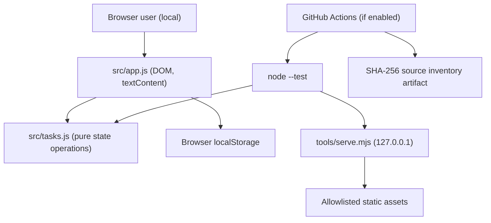

# CONSTRUCTOR AI — Architecture and Security Boundary v0.1

**Status:** Mixed evidence: reference source E2; platform components E0/E1 until independently verified.  
**Author attribution:** Alexander Romaskevich (RomaskevicH). **Canonical intelligence name: VELION.**

## 1. Actual contents and runtime diagram

**Implemented:** no backend database, autonomous model execution, live crypto payments or arbitrary code runner. The server binds loopback by default and serves only allowlisted read-only static assets. Browser data is stored in localStorage, which is per-origin and not a secure store for secrets.

## 2. Planned secure agent pipeline (NOT deployed by this source tree)

```mermaid
flowchart LR
  U["User"] --> I["IntentLock"]
  I --> H["HANTER / VELION advisory"]
  H --> P["Universal NCA planner & coder"]
  P --> A["AI Passport / Signed Agent Permit"]
  A --> G["Guardian Core / Approval Gateway"]
  G --> S["Isolated sandbox (future)"]
  S --> V["Independent QA + ProofGraph"]
  V --> L["Audit Ledger + Proof Passport"]
  L --> O["Owner release decision"]
```

### Invariants

- No single global unrestricted runtime orchestrator. Professional NCA roles are scoped to authorized domains.
- Identity ≠ Authority; Capability ≠ Approval; Intelligence ≠ Privilege.
- No generated code execution outside an independently validated isolated sandbox.
- Secrets are never forwarded to client-side LLM code or published artifacts.
- Third-party provider availability and costs do not imply the existence of a working AI adapter.
- Model output and generated code are untrusted until checked, sanitized where applicable and independently tested.
- Human authorization is required for deployments, financial transfers, privileged access and safety-relevant actions.
- A signed permit, model registry or ProofGraph in documentation is **not** proof the mechanism exists in code.

## 3. Testable local reference contract

**Task** record: `id`, `title`, `description`, `completed`, `createdAt`, `updatedAt`.

- `title`: trimmed printable text; 1–120 characters.
- `description`: optional string, max 500 characters, control characters rejected.
- At most 250 locally stored tasks; IDs are unique and validated.
- Invalid persisted JSON or records are not executed. The UI displays a warning on malformed data.
- Create, update, toggle, filter, count and delete are pure immutable domain operations.
- DOM uses `textContent` instead of interpreting task names as HTML.
- Browser localStorage may fail; failures must not crash the in-memory UI.
- Local server accepts GET and HEAD only; non-allowlisted paths return 404 and other HTTP methods 405.

## 4. Trust boundaries and failure analysis

| Threat | Reference mitigation | Remaining risk |
|---|---|---|
| User-controlled title contains HTML | textContent, no innerHTML | No complete browser E2E test yet |
| Tampered storage | schema-like validation, duplicate ID rejection | No secure multi-device sync |
| Malicious URL or path | explicit static allowlist in local server | Server not hardened for internet exposure |
| Secret leakage | no external provider keys, no fetch or payments | Public Git history needs routine scanning |
| Dangerous model-generated code | not accepted/executed in reference | Isolated AI sandbox not delivered |
| Stale/inconsistent quotas | 250 task hard limit, pure state checks | Distributed quota admission design pending |
| Failed localStorage writes | UI warning, volatile session fallback | Data can be lost |
| CI compromise or workflow changes | read-only contents permissions | Branch rules and CI trust not yet independently validated |

## 5. Next milestone

Implement a **real model adapter** with valid credentials, then transmit plan to a **separately isolated, owner-authorized sandbox**, generate and test one Task Manager application end-to-end. Do not substitute this manually created reference app as proof of that AI path.

## 6. Scale claims

The parent IMPERIAL Core initiative envisions a digital corporation of universal NCA identities up to one billion. That number is **an architectural horizon**, not a CONSTRUCTOR AI concurrency test, current agent count or production capacity.
