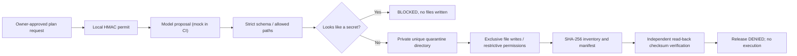

# CONSTRUCTOR AI — Proof-carrying Quarantine v0.3

**Owner:** Alexander Romaskevich · RomaskevicH · IMPERIAL Core  
**Scope:** Source-implemented, non-executing draft packaging with an offline mock-provider integration test.  
**Invariant:** NOT A SANDBOX · NOT SIGNED · NO CODE EXECUTION · NO RELEASE · FREE_ONLY.

## Engineering flow



## What is actually implemented

- `engineering/draft-contract.mjs`: validates bounded draft plans and relative source paths before any storage.
- `engineering/static-review.mjs`: flags probable process execution, filesystem access, network calls and environment access. Certain recognizable token formats are blocked entirely. It is NOT a complete secret scanner or proof of security.
- `engineering/proof-bundle.mjs`: uses a fresh, private local directory inside an **existing operator-controlled directory**; creates text files exclusively without following symlinks; records each file hash, byte length and the manifest hash; then re-verifies bytes from disk.
- `verifyProofBundle()`: validates manifest, disallows symlinks and unlisted content, reads each file and compares SHA-256 and the original draft content digest. It NEVER runs generated code.
- `test/offline-integration.test.js`: exercises mocked model response → local permit → validated plan → quarantine → read-back verification. This is a real offline integration test, not a real Groq integration.
- `test/proof-bundle.test.js`: negative tests cover forged claims, secret material, symlinks, altered content, manifest modification and unexpected files.

## Evidence levels

| Proof | What it establishes | Not established |
| --- | --- | --- |
| SHA-256 file inventory | Local contents match saved manifest | Authorship, confidentiality, absence of malicious code |
| Manifest digest | Local manifest has not been accidentally changed without recomputing hash | Cryptographic signature or external trust |
| Offline mock-provider E2E | Contracts compose and data survives disk roundtrip | Real Groq inference, provider quotas, sandbox protection |
| Scoped process-local HMAC permit | Request had a known shared secret in this process | Human identity, globally durable replay prevention |
| Heuristic scan | Certain recognizable red flags are surfaced | Secure execution, independent QA |

The quarantine API receives a JavaScript result object. It **cannot cryptographically distinguish a forged receipt** from a trusted caller's receipt. Only the owner-controlled runner should pass the result directly from its model gateway; loading arbitrarily supplied receipts as trusted proof is prohibited. The selected output directory must not be writable by adversaries, because a filesystem race can invalidate the containment model.

## Free / offline verification

```bash
npm run check
npm test
npm run verify
node tools/generate-plan.mjs --help
npm run proof:verify -- --bundle /absolute/path/to/constructor-quarantine-XXXXXX
```

To optionally use the real Groq API **only with verified owner-approved free-tier access and live credentials**, configure `GROQ_API_KEY`, `GROQ_MODEL` and a newly generated `PLAN_AUTH_KEY` of at least 32 bytes. Do not commit credentials. Create an existing trusted output directory. Then:

```bash
mkdir -p ./quarantine-output
npm run plan -- --goal "Plan a Task Manager application" --confirm-inference \
  --quarantine-root ./quarantine-output --confirm-quarantine
```

The CLI displays the quarantine path and hashes; **it does not execute, compile, install, host or deploy** model-generated code.

## Next real milestone

Build a separate hardened, ephemeral sandbox worker; durable scoped permit revocation; independent QA processes; reproducible build/test evidence and signed Proof Passport anchored to a known, reviewed source commit. Before those are implemented and independently exercised, **E5 autonomous delivery and E6 production are blocked**.

**Source integrity ≠ executable safety.** A strong product should require proof rather than infer proof from documentation.
