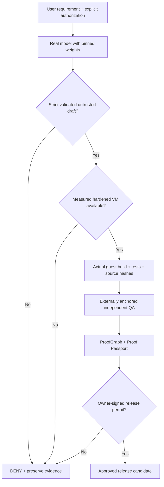

# Real LLM + protected VM acceptance path — next engineering gate

**Status (25 October 2026):**
- **TESTED** — [separate signed CI QA](INDEPENDENT_CI_QA.md), GitHub OIDC/Sigstore provenance, exact artifact hashes.
- **TESTED AS A CONTRACT** — local model observation admission and external-key-signed VM claim parsing, including negative paths.
- **NOT VERIFIED** — actual Qwen model inference, AI-generated working application, hardened VM guest run, hardware-backed guest attestation or release.

These distinctions must be maintained in all investor materials. The current Docker CI test uses intentionally synthetic source. Docker shares the host kernel; it cannot silently satisfy the VM requirement.

## Stage L1 — genuine no-cloud-key model attempt

**Open-weight candidate:** [Qwen2.5-Coder-0.5B-Instruct-GGUF (Apache-2.0)](https://huggingface.co/Qwen/Qwen2.5-Coder-0.5B-Instruct-GGUF). The specific 429 MB `q4_0` GGUF model is pinned by `sha256:9739055e046d62a937e5b7879012209ef40ebea8a1569a96028de491f3f091d5`.

Files:
- [run-local-qwen.py](../tools/run-local-qwen.py) — real local `llama-cpp-python` inference; **does not use a fake response or execute its generated code**. Checks existing GGUF file size and exact byte hash before model load.
- [local-model-admission.mjs](../engineering/local-model-admission.mjs) — strict `constructor_draft_v1` JSON admission, mission/response hash binding, blocked incomplete answers, denied secret/network-capable drafts.
- [admit-local-model.mjs](../tools/admit-local-model.mjs) — separate read-only inspection of the model output report.
- [negative tests](../test/local-model-admission.test.js) — deterministic tests with **synthetic fixtures only**.

Reproduction on an authorized local computer with the free dependencies and official model downloaded independently:

```bash
python3 -m pip install llama-cpp-python==0.3.36
# Obtain qwen2.5-coder-0.5b-instruct-q4_0.gguf from the official model repository.
python3 tools/run-local-qwen.py \
  --model-file /path/to/qwen2.5-coder-0.5b-instruct-q4_0.gguf \
  --goal "Create a small JavaScript task management module with tests." \
  --confirm-real-inference
npm run llm:admit -- --goal "Create a small JavaScript task management module with tests."
```

The model may produce invalid JSON or fail security admission. **That is a failed attempt, not a successful app.** The local report merely describes a model invocation and is not cryptographically externally attested. Inference must stay opt-in, never connect to paid providers automatically, and log source hashes without posting private prompts.

## Stage V1 — separate protected VM, NOT Docker

[VM trust boundary](../engineering/vm-trust-boundary.mjs) verifies a signed **operator claim** from an externally pre-enrolled public key. It binds mission, source bytes, test-log bytes, VM image ID, a short validity window and nonce. Incorrect/expired/cross-mission records or missing trust anchors are rejected.

**Important:** Verifying an operator signature does **not** prove that a VM guest actually booted or that its kernel measurement is authentic. This module deliberately reports `guest_attestation: NOT_VERIFIED` and `release: DENIED`.

A real VM executor must satisfy the following acceptance requirements before any AI-drafted source is allowed near an execution backend:

1. A distinct microVM/VM guest kernel and isolation boundary from the host developer process; never Node `vm`, `eval` or host `child_process` for untrusted generated source.
2. Enforced network denial, disposable read-only root, non-root guest, isolated storage, CPU/RAM/IO/wall-time and output limits. No developer secrets, GitHub credentials, Docker socket, SSH agent or production wallets inside guest.
3. Image provenance (pinned digest, source/license scan and signed publisher attestations), a measured guest environment or independently authenticated VM service claim; no downgrade to a container when guest isolation is unavailable.
4. Guest-generated source/test log and exit-code receipts cryptographically bound to an owner-authorized mission. Separately controlled QA must rerun acceptance tests and verify artifact bytes.
5. Durable revocation/replay protection, independently provisioned signing keys, OIDC-backed workload identity and explicit owner-signed release permission.
6. All errors, missing quotes/measurements and VM or model unavailability are **BLOCKED / DENIED**. No automatic pay-as-you-go service provisioning under FREE_ONLY.

GitHub-hosted standard Actions runners themselves are VMs, but their existence is **not proof of a distinct hardened VM guest for arbitrary model-generated code**. GitHub warns that nested virtualization on hosted runners is experimental and not officially supported.

## Stage B1-B4 full application acceptance (NOT SHIPPED)



**No automatic fallback to existing Docker CI, stub providers, self-signed identity or synthetic input is permitted to claim a completed real-LLM+VM lifecycle.** ProofGraph coverage means human review candidate only, not a production product.
